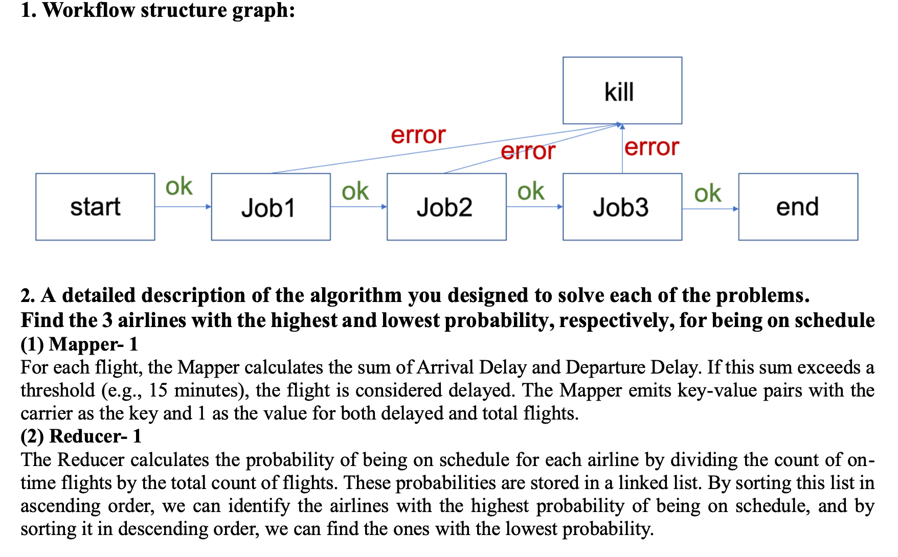
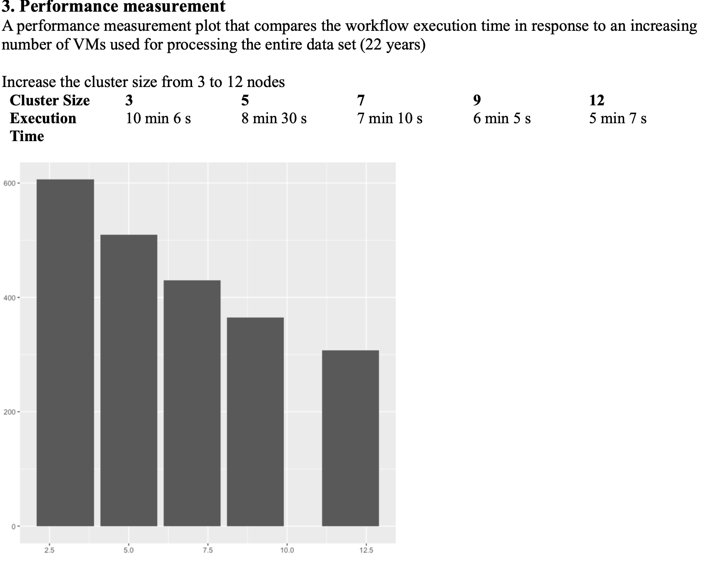
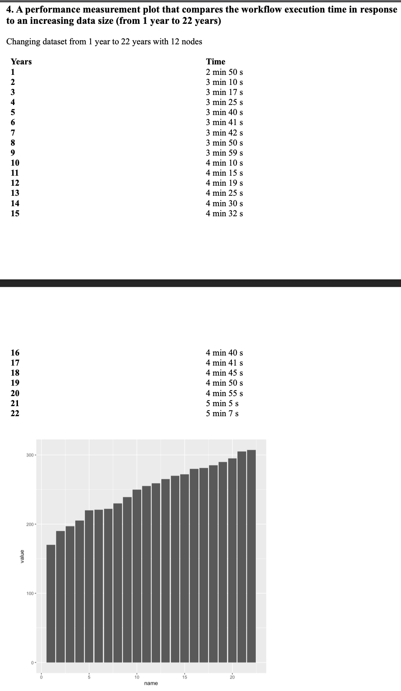
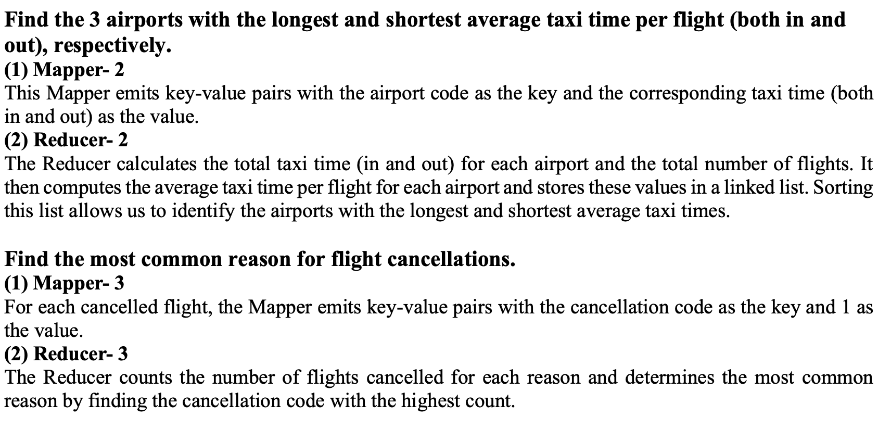

# Flight Data Analysis with MapReduce

This project leverages MapReduce (Hadoop) and Oozie to analyze 22 years of US flight data. It identifies key patterns such as airline punctuality, airport taxi times, and cancellation reasons through a sequence of MapReduce jobs managed by an Oozie workflow.

## Project Contents

```bash
 flight.java        # Java MapReduce logic (3 jobs)
 flight.jar         # Compiled JAR for Hadoop execution
 workflow.xml       # Oozie workflow configuration
 command.txt        # Setup and execution steps for Hadoop, Oozie, MySQL
 output.txt         # Sample result from MapReduce jobs
 public/
 ├── Screenshot 2025-05-22 at 6.57.41 PM.png
 ├── Screenshot 2025-05-22 at 6.58.04 PM.png
 ├── Screenshot 2025-05-22 at 6.58.16 PM.png
 └── Screenshot 2025-05-22 at 6.58.42 PM.png
```

## Output Summary

- **On-Time Airlines:** Identifies airlines with the highest and lowest probability of being on time.
- **Taxi Time:** Determines airports with longest and shortest average taxi time.
- **Cancellations:** Reports the most common reasons for flight cancellations.

Example:
```
Airlines with 100% on-time:
YV7958, YV7003, YV6790
Airlines with 0% on-time:
9E2072, 9E2076, 9E2102
```

## How to Run (via Oozie)

- Ensure Hadoop and Oozie are installed and configured.
- Upload flight data and JAR files to HDFS.
- Submit Oozie job with `workflow.xml` and `job.properties`.
- Track job status via CLI or Oozie UI.

## Visuals

### Workflow Graph


### Execution Metrics


### Time vs Years


### Output Snapshot


## Ignored Files

- `Project_Report.pdf`  (academic write-up)
- `*.class`, `*.log`, `*.tmp`

## Author

Nikhil Yarra

---

For setup commands and detailed configuration steps, refer to [`command.txt`](command.txt).
